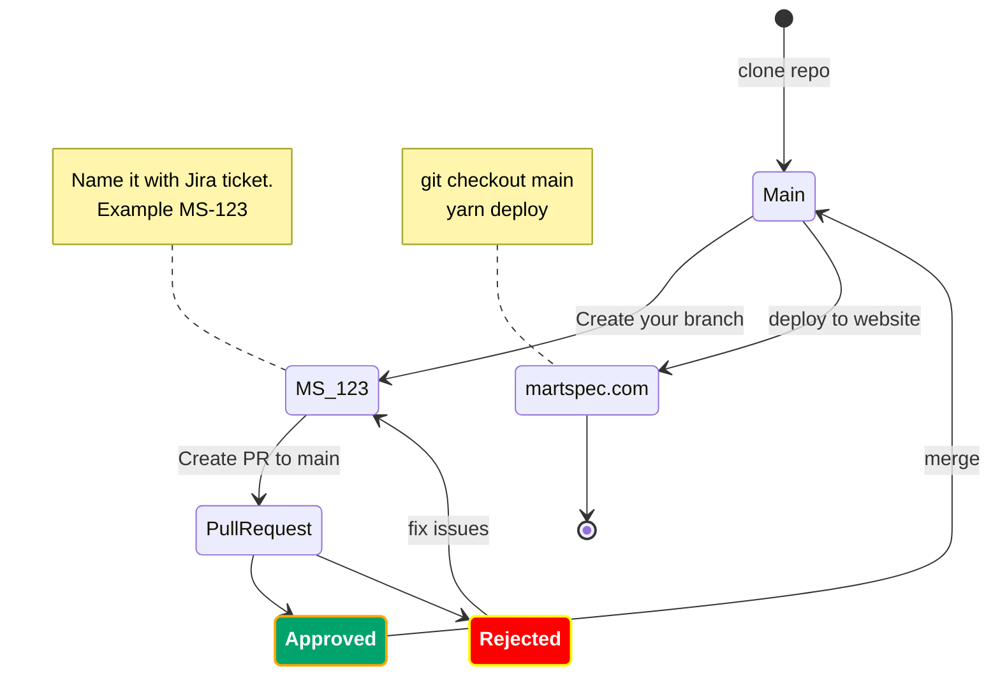

## About

[Martspec](https://martspec.com/) is focused on promoting a healthy lifestyle. Our objective is to assist users in leading a healthier lifestyle by considering their vitamin and mineral intake, psychological well-being, and body characteristics.


## Install

```
git clone <repo link>               # Clone repo to your local computer
cd ms                              # Enter the cloned repository

nvm current                         # Check current *node* version
nvm install                         # Install the Node version in .nvmrc
nvm use                             # Use the repo’s Node version

npm install -g corepack             # Install Corepack (not bundled with Node 26)
corepack enable                     # Enable the pinned Yarn version
yarn install --immutable            # Install the locked dependencies
yarn svr                            # Run website locally

yarn upgrade-interactive            # Review dependency updates
```

The project uses Node 26.13.1 and Yarn 4.18.1, selected by Corepack from `package.json`. Yarn uses the `node_modules` layout and `yarn.lock` for reproducible installs. If another global Yarn installation takes precedence, use `corepack yarn` or adjust your PATH.

`yarn svr` uses port 3000. To request a different port, run `yarn svr --port 8080`, or use `yarn svr --port auto` to select an available port. If a port reports `EADDRINUSE`, another process owns it: reuse its server, stop it yourself, or choose another port.

`yarn dev` starts the website and Ladle together, with Ladle on port 3001 for the `/development` proxy. Stopping either process stops both. Port 3001 must be available for this combined command.

Validation: `yarn typecheck` and `yarn build` (the site and Ladle builds). `yarn deploy` runs `yarn build` before publishing to GitHub Pages. React stays on 18.x for Ladle’s inspector peer compatibility, and TypeScript stays on 6.x because Ladle’s published typings fail under 7.x. Third-party declaration checking is skipped; application and story code are still checked.

Project styles use Sass modules (`@use`) and namespaced built-in functions. Sass deprecations from dependencies are excluded with `quietDeps` while Bootstrap 5 still uses legacy Sass internally; warnings in project styles remain enabled. Cross-module selector aliases are collected at the end of `src/sass/main.scss` to preserve the existing styles.

Development builds use Webpack's filesystem cache in `node_modules/.cache/webpack` and reuse the Sass compiler. The first build populates the cache; later server starts can reuse it. Webpack tracks source and configuration dependencies to invalidate cached results when they change.

## Workflow



## Ladle stories

We use [ladle](https://ladle.dev/) to create and use example-components (stories). <br/>
Go to [martspec.com/development](https://martspec.com/development) to see the components we have developed.
<br />

commands:

```
yarn ladle serve                    # Start dev server locally
```

## Images WebP

We use **webp** format for non SVG images on the site. When we get new images from designer do this:

1. Copy PNG images to an empty _/src/img/new_ folder.

2. Run script _/src/img/img.sh_:
    - open the Git Bash terminal
    - run `./src/img/img.sh`
3. Delete images from the _/src/img/new_ folder after checking the resulting images.

This will create .webp images in _/src/img_ folder whose max size would be 512px.

#### Script settings 🛠️:

-   `DIR_INPUT` - the source directory with the images to convert (relative to the script folder). Default value `new` for _/src/img/new_ folder.

-   `DIR_OUT` - the output directory with the resulting images (relative to the script folder). Default empty value for _/src/img_ folder.

-   `MAX_SIZE` - maximum size in px for the image height and width. Default value: `512`.

#### In order to run the script you need to install the following aps:

-   [cwebp](https://developers.google.com/speed/webp/download) - WebP encoder tool to compress an image file to a WebP file

-   [pngcrush](https://pmt.sourceforge.io/pngcrush/) - an optimizer for PNG files

-   for non-macOS operating systems:

    -   [magick](https://imagemagick.org/script/download.php) - command line tool from ImageMagick
        > on macOS the script uses [sips](https://ss64.com/mac/sips.html) - the macOS command line tool
